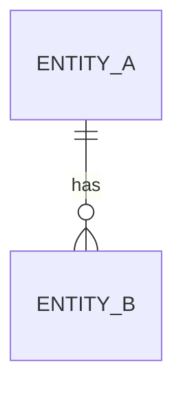

# SCHEMA — {PROJECT_NAME}

> High-level database description for the SCRUM agent. **Not SQL.** Real DDL lives in the code repo. This file is the conceptual map.

---

## Meta

- **Backend:** {Supabase / Firebase / other}
- **Engine:** {PostgreSQL 15 / Firestore / etc.}
- **Multi-tenancy:** {RLS by `organization_id` / per-document rules / single-tenant}
- **Last updated:** {YYYY-MM-DD}
- **Source of truth:** the code repo migrations (`code-{stack}/sql/migrations/` or equivalent). This file is a synthesis.

---

## 1. Domains

The schema is organized in logical domains. Each domain groups entities that change together.

|Domain|Purpose|Entities|
|---|---|---|
|{Identity & Access}|{Users, organizations, roles}|`users`, `organizations`|
|{Domain 2}|...|...|

---

## 2. Entities

For each entity: purpose, key fields (not exhaustive), critical constraints, RLS policy in plain English.

### `entity_name`

- **Domain:** {which domain it belongs to}
- **Purpose:** {what it represents}
- **Owned by:** {organization_id / user_id / customer_id}
- **Key fields:**
    - `id` (uuid, pk)
    - `organization_id` (uuid, fk → organizations)
    - `{key business fields}`
    - `created_at`, `updated_at`, `deleted_at` if soft-delete
- **Constraints:**
    - {unique, check, fk constraints worth knowing}
- **RLS:**
    - Read: {who can read}
    - Write: {who can write}
    - Notes: {any RPC that bypasses normal RLS}

---

## 3. Cross-cutting rules

- **Multi-tenancy:** every business entity has `organization_id`. RLS denies cross-tenant reads/writes. Service role bypasses RLS only via `SECURITY DEFINER` RPCs.
- **Soft-delete:** entities supporting it have `deleted_at`. Queries must filter `deleted_at IS NULL` unless explicitly showing trash.
- **Audit:** `created_at` and `updated_at` are auto-managed by triggers. `updated_at` is updated on every row change.
- **JWT claims:** `organization_id` and `app_role` are injected via `custom_access_token_hook`. RLS policies use `app_role`, not the reserved `role` claim.

---

## 4. Key RPCs

For multi-table or complex operations, the system uses Postgres RPCs with `SECURITY DEFINER`. Document the ones the SCRUM should know about.

### `rpc_name(args)`

- **Purpose:** {what it does in business terms}
- **Triggers writes to:** {tables}
- **Atomicity:** ACID guaranteed
- **Notes:** {known issues, version history if relevant}

---

## 5. Diagrams

Mermaid for relationships, especially when more than 4 entities interact.

---

## 6. Known gaps and inconsistencies

Things that exist in the schema but are quirky, deprecated, or in transition. Important for the SCRUM to know so it does not repeat mistakes.

- {gap 1}
- {dual schema dev/public if applicable}

---

## 7. References

- Migrations: `code-{stack}/sql/migrations/` (or wherever they live)
- Migration history: `code-{stack}/migraciones.md` (if maintained)
- Related ADRs: {list}

---

**Template version:** v1.0